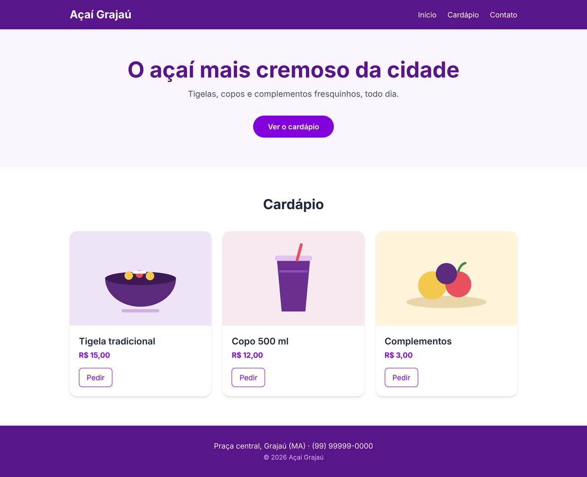

# Açaí Grajaú com Tailwind · Desafio prático

O `index.html` já tem todo o texto da página do Açaí Grajaú, uma loja fictícia, mas sem nenhuma classe. O Tailwind já está ligado à página.

**Sua missão: deixar a página igual ao print `resultado.png`, usando só classes do Tailwind.**


1. Olhe o print e veja o que precisa: "fundo roxo", "texto branco", "tudo na mesma linha"...
2. Procure cada coisa na documentação: <https://tailwindcss.com/docs> (use a busca, **Ctrl + K**).
3. Coloque a classe e confira no navegador.



---

## Como começar

1. Abra o `index.html` no navegador. Precisa de internet, porque o Tailwind vem do CDN.
2. Deixe a documentação aberta em outra aba.

```
projeto_inicial_tailwind/
├── index.html               ← você trabalha aqui
├── resultado.png            ← como a página deve ficar no computador
├── resultado-celular.png    ← e no celular
└── img/
```

> Ao abrir, você vai notar que até o `<h1>` está do tamanho do texto comum. Não é erro: o Tailwind zera todos os estilos do navegador. Tudo o que aparecer na tela vem das suas classes.

---

## Parte 1 · Cabeçalho

**Na documentação:** Flex, Justify content, Align items, Gap, Padding, Background color

- Fundo roxo-escuro (`bg-purple-900`) e texto branco.
- O nome à esquerda e os links à direita, na mesma linha.
- No celular, o nome fica em cima e os links embaixo, centralizados.
- Os links ficam lado a lado, com espaço entre eles.

> Dica: `flex flex-col md:flex-row` no `<nav>` faz a troca de coluna para linha a partir de 768px. Para o conteúdo não encostar nas bordas em telas grandes, use `max-w-5xl mx-auto`.

## Parte 2 · Banner

**Na documentação:** Font size, Font weight, Text align, Padding, Border radius, Hover and other states

- Fundo roxo bem claro (`bg-purple-50`), tudo centralizado e com bastante espaço em cima e embaixo.
- Título grande e em negrito, em roxo.
- O link "Ver o cardápio" vira um botão roxo, arredondado (`rounded-full`), que escurece quando o mouse passa por cima.

> Dica: um link só aceita espaçamento em volta se for `inline-block`.

## Parte 3 · Cardápio

**Na documentação:** Grid template columns, Responsive design, Box shadow, Border radius, Overflow, Transition

- Os três produtos ficam lado a lado no computador e empilhados no celular.
- Cada produto vira um "card": fundo branco, cantos arredondados e sombra.
- O preço fica em negrito, em roxo, e o botão "Pedir" tem só a borda.
- Ao passar o mouse, o card sobe um pouco e a sombra aumenta.

> Dica: `grid md:grid-cols-3 gap-6` em uma `<div>` em volta dos três `<article>`. Para a imagem respeitar o canto arredondado do card, use `overflow-hidden` no card.

## Parte 4 · Rodapé

**Na documentação:** Background color, Text color, Padding, Text align

- Mesmo roxo do cabeçalho, com o texto claro e centralizado.
- O copyright em letra menor.
